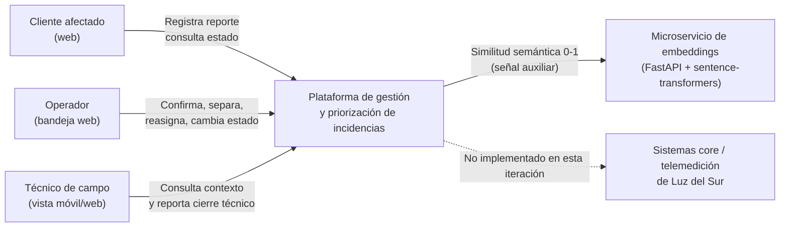
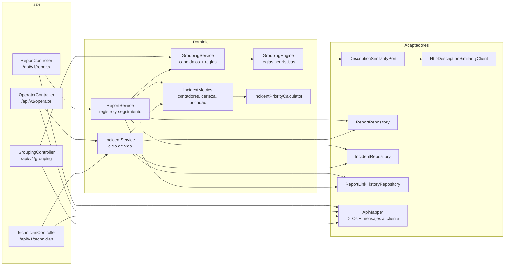
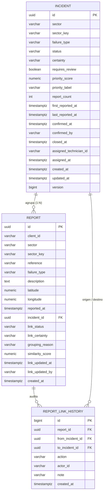
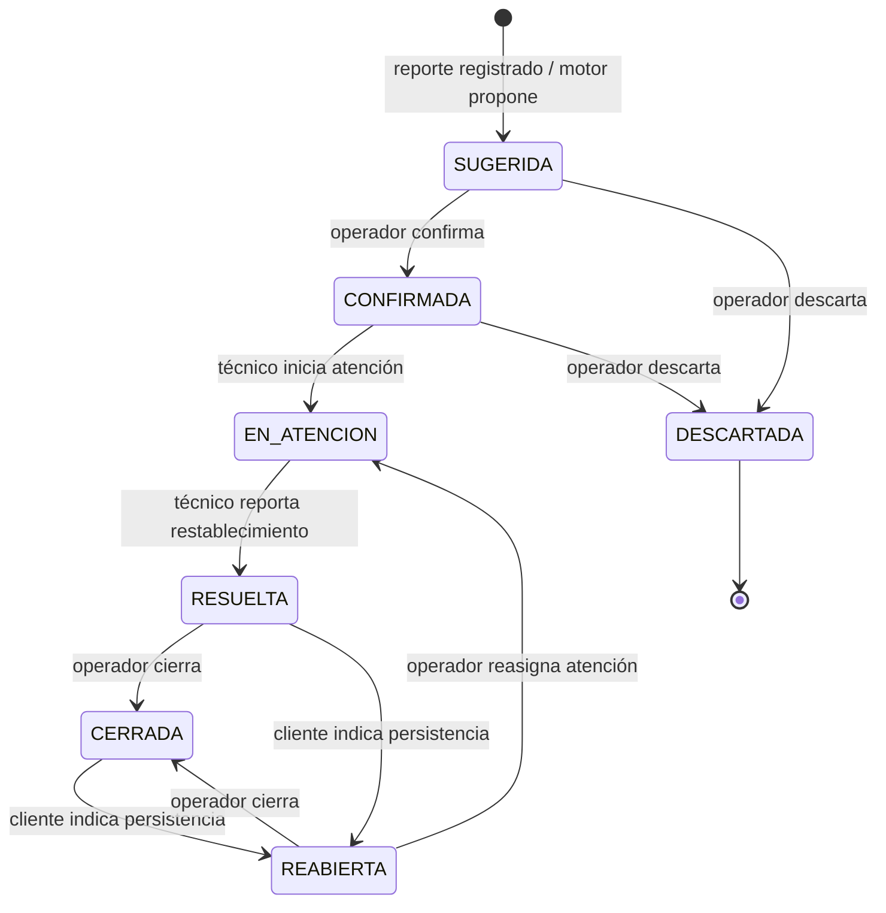

# Arquitectura de la solución — Backend y despliegue (Persona 1)

**Proyecto:** Sistema inteligente para la gestión y priorización de incidencias eléctricas en Luz del Sur
**Curso:** Innovación y Transformación Digital — UPC
**Alcance de este documento:** componentes, flujos, modelo de datos, despliegue y decisiones técnicas del backend. Complementa el punto 4 del Avance 2 y el plan de validación del punto 7.

---

## 1. Propósito y alcance

El backend es la capa que convierte reportes individuales de clientes en **propuestas de incidencia revisables** por un operador. No reemplaza los canales de Luz del Sur ni despacha cuadrillas de forma automática: aplica reglas explícitas, conserva cada reporte original y deja la decisión final en manos de una persona (*human-in-the-loop*).

| Incluido en esta entrega (Persona 1) | Fuera de alcance / otra persona |
| --- | --- |
| API REST en Spring Boot con motor heurístico | Autenticación JWT, roles y auditoría completa (Persona 3) |
| Llamada HTTP tolerante a fallos al microservicio de embeddings | Modelo real de embeddings (Persona 5) |
| Modelo operativo PostgreSQL + migración base `V1` y `V2` | Migraciones `V3+` de usuarios y auditoría (Persona 3) |
| Dockerización, `docker-compose`, Nginx con HTTPS y variables de entorno | Vistas React (Personas 2 y 4) |
| Pruebas del motor y del flujo principal | Pruebas funcionales de las tres vistas y video (Persona 4) |

> El prototipo opera con datos simulados y no se conecta a sistemas *core* de la distribuidora (punto 4.6 del informe).

---

## 2. Vista de contexto (C4 — nivel 1)



**Lectura para el informe:** la plataforma se ubica como capa intermedia de consolidación; los actores siguen usando canales web. La integración con *core* está explícitamente excluida (punto 4.6) y se dibuja punteada para no confundirla con una funcionalidad existente.

---

## 3. Vista de contenedores (C4 — nivel 2)

```mermaid
flowchart TB
    subgraph Internet
        U["Navegador del cliente / operador / técnico"]
    end

    subgraph Servidor propio (Docker Compose)
        NG["Nginx<br/>TLS 1.2/1.3 · rate limit · headers"]
        BE["Backend Spring Boot<br/>:8080 · API + motor heurístico"]
        DB[("PostgreSQL 17<br/>volumen pgdata")]
        EM["Microservicio embeddings<br/>:8000 (red interna)"]
    end

    U -->|"HTTPS 443"| NG
    NG -->|"HTTP red interna 8080"| BE
    BE -->|"JDBC 5432"| DB
    BE -->|"HTTP 8000 · timeout 1,5 s<br/>cooldown 30 s"| EM
```

| Contenedor | Tecnología | Responsabilidad | Exposición |
| --- | --- | --- | --- |
| `proxy` | Nginx 1.27 | Terminación TLS, redirección 80→443, límites de tasa, cabeceras de seguridad, único punto de entrada | `80`, `443` |
| `backend` | Spring Boot 3.5 / Java 21 | API REST, motor heurístico, validación, transacciones, priorización, métricas | Solo red interna `8080` |
| `db` | PostgreSQL 17 | Persistencia de incidencias, reportes e historial de vínculos | Solo red interna `5432` |
| `embeddings` | FastAPI (Persona 5) | Similitud semántica entre descripciones | Solo red interna `8000` |

**Decisión clave:** base de datos y microservicio **no publican puertos** al host. El único servicio expuesto es Nginx, lo que reduce la superficie de ataque y permite rotar credenciales sin tocar el cliente.

---

## 4. Vista de componentes del backend



| Componente | Responsabilidad | Archivo principal |
| --- | --- | --- |
| `GroupingEngine` | Decide si un reporte se vincula a un caso abierto y con qué certeza. **Sin acceso a base de datos**, lo que permite probarlo de forma aislada. | `grouping/GroupingEngine.java` |
| `GroupingService` | Carga candidatos por sector/ventana/tipo y arma las descripciones recientes para la señal semántica. | `grouping/GroupingService.java` |
| `ReportService` | Persiste el reporte **antes** de cualquier decisión, crea o reutiliza la incidencia y registra el vínculo sugerido. | `report/ReportService.java` |
| `IncidentService` | Confirma, separa, reasigna, cambia estados y reabre casos. Toda corrección deja historial. | `incident/IncidentService.java` |
| `IncidentMetrics` | Recalcula `reportCount`, certeza (la peor de sus reportes) y prioridad tras cada cambio. | `incident/IncidentMetrics.java` |
| `DescriptionSimilarityPort` | Interfaz que desacopla el motor del proveedor de embeddings; permite pruebas sin red. | `embeddings/…Port.java` |
| `HttpDescriptionSimilarityClient` | Cliente HTTP con timeout y enfriamiento ante fallos. | `embeddings/…Client.java` |
| `ApiMapper` | Traduce entidades a DTOs y centraliza los mensajes comprensibles para el cliente. | `api/ApiMapper.java` |

### Separación de capas

`Controller → Service → Repository` con entidades que encapsulan sus invariantes (`Incident.markConfirmed`, `Report.detach`, etc.). El motor no conoce HTTP ni JPA: recibe datos y devuelve una propuesta con motivos, lo que hace que las reglas sean **auditables y testeables**.

---

## 5. Flujo principal: registro de un reporte

```mermaid
sequenceDiagram
    autonumber
    actor C as Cliente
    participant N as Nginx (TLS)
    participant API as ReportService
    participant DB as PostgreSQL
    participant GS as GroupingService
    participant GE as GroupingEngine
    participant EM as Microservicio embeddings

    C->>N: POST /api/v1/reports (HTTPS)
    N->>API: Proxy HTTP (red interna)
    API->>DB: Buscar casos abiertos del sector dentro de la ventana
    DB-->>API: Candidatos (máx. 5)
    API->>GS: Evaluar reglas
    GS->>GE: sector + tiempo + tipo + descripciones
    alt Embeddings disponibles
        GE->>EM: POST /api/v1/similarity/batch
        EM-->>GE: Similitudes 0-1
    else Timeout / error
        GE->>GE: Continúa solo con reglas (certeza MEDIA)
    end
    GE-->>GS: Propuesta + certeza + motivos
    GS-->>API: Propuesta
    API->>DB: Guardar reporte original + vínculo SUGERIDO
    API-->>C: UUID, estado, mensaje comprensible
    Note over API,DB: El reporte se guarda siempre;<br/>la agrupación queda pendiente de confirmación humana.
```

### Pasos implementados

1. Validación del cuerpo (tipo de falla, descripción, fecha no futura).
2. Normalización del sector (tildes, mayúsculas, espacios). Valores como “sin sector” se tratan como ubicación incompleta.
3. Búsqueda de candidatos abiertos (`SUGERIDA`, `CONFIRMADA`, `EN_ATENCION`, `REABIERTA`) del mismo sector dentro de la ventana configurable.
4. Evaluación de reglas y, si aplica, consulta al microservicio de embeddings con *timeout*.
5. Persistencia del reporte **original** y del vínculo como `SUGERIDO`.
6. Recalculo de certeza y prioridad del caso.
7. Respuesta con identificador y mensaje para el cliente.

Si el operador confirma, todos los reportes pasan a `CONFIRMADO`. Si separa o reasigna, el reporte conserva su UUID y se registra el movimiento en `report_link_history`.

---

## 6. Motor de agrupación heurística

### 6.1 Reglas declaradas (punto 4.5 del informe)

| Regla | Implementación | Configuración |
| --- | --- | --- |
| R1 — Proximidad | Igualdad de `sector_key` normalizado (sector o cuadrante declarado) | — |
| R2 — Temporalidad | Diferencia absoluta entre el reporte y la última actividad del caso ≤ ventana | `GROUPING_WINDOW_MINUTES` (15/30/60) |
| R3 — Tipología | Igualdad de `failure_type` | — |
| Señal auxiliar | Similitud semántica máxima contra las 4 descripciones más recientes del caso | `EMBEDDINGS_*` |

### 6.2 Matriz de decisión

| Condición | Decisión | Certeza | Revisión explícita |
| --- | --- | --- | --- |
| Sector + tiempo + tipo + similitud ≥ 0,55 | Vincular al caso | `ALTA` | No |
| Sector + tiempo + tipo, embeddings deshabilitado | Vincular (solo reglas) | `ALTA` | No |
| Sector + tiempo + tipo, embeddings caído | Vincular con degradación | `MEDIA` | No |
| Sector + tiempo + tipo, similitud intermedia | Vincular, confirmar manualmente | `MEDIA` | No |
| Sector + tiempo + tipo, similitud ≤ 0,30 | Vincular como posible falso positivo | `BAJA` | **Sí** |
| Sector + tiempo, **tipo distinto** (C2) | Vincular como dudoso | `BAJA` | **Sí** |
| Sin sector/ambiguo, con candidato del mismo tipo (C5) | Vincular tentativamente | `BAJA` | **Sí** |
| Sin sector/ambiguo, sin candidatos (C5) | Caso nuevo | `BAJA` | **Sí** |
| Sin candidatos en ventana (C3/C4) | Caso nuevo | `ALTA` | No |

La certeza de la **incidencia** es la peor de sus reportes: un solo reporte con ubicación incompleta obliga a revisar el caso completo. `requiresReview` se activa solo con certeza `BAJA` y el caso aún abierto.

### 6.3 Por qué embeddings como señal y no como decisión

- Las reglas son explicables y defendibles ante el operador y el docente.
- El microservicio puede fallar o tardar; el registro de reportes **nunca** depende de él.
- La similitud solo **refuerza o degrada** la certeza; no crea ni elimina vínculos por sí sola.
- El umbral es configurable para las pruebas H3 (precisión/exhaustividad con 15, 30 y 60 minutos).

### 6.4 Priorización

`score = 40·min(reportes,10)/10 + 30·peso(tipo) + 30·min(horas/6,1)`

| Tipo de falla | Peso |
| --- | --- |
| `CORTE_TOTAL` | 1,00 |
| `BAJA_TENSION` | 0,75 |
| `INTERMITENCIA` | 0,60 |
| `MEDIDOR` | 0,50 |
| `OTRO` | 0,40 |
| `ALUMBRADO_PUBLICO` | 0,35 |

Etiquetas: `CRITICA ≥ 70`, `ALTA ≥ 50`, `MEDIA ≥ 30`, `BAJA < 30`. Es una **propuesta de prototipo**, no un protocolo oficial de despacho (punto 4.5).

---

## 7. Modelo de datos operativo



| Decisión | Motivo |
| --- | --- |
| `UUID` como clave del reporte | Se entrega al cliente y no revela volumen ni secuencia; facilita integraciones futuras |
| Relación 1:N incidencia-reporte | Un caso consolidado mantiene visibles sus reportes de origen (punto 4.2) |
| Reporte sin borrado lógico | El dato del ciudadano nunca se altera ni se elimina |
| `sector_key` normalizado | Evita falsos negativos por tildes/mayúsculas; se conserva `sector` para mostrar |
| `report_link_history` | Trazabilidad de confirmar, separar y reasignar sin depender de logs |
| `version` (`@Version`) | Evita que dos operadores sobrescriban el mismo caso (bloqueo optimista) |
| `assigned_technician_id` | Permite filtrar la bandeja del técnico por responsable real, sin inventar un modelo de flota |
| `grouping_reason` y `similarity_score` | El operador ve **por qué** se propuso la agrupación |

La migración base es `backend/src/main/resources/db/migration/V1__baseline.sql`. Persona 1 añade `V2__technician_assignment.sql` (asignación al iniciar atención); Persona 3 agrega `V3+` (usuarios, roles, auditoría) sin modificar `V1` ni `V2`.

---

## 8. Máquina de estados



| Transición | Quién | Efecto |
| --- | --- | --- |
| `SUGERIDA → CONFIRMADA` | Operador | Reportes pasan a `CONFIRMADO`; se registra actor y fecha |
| `SUGERIDA/CONFIRMADA → DESCARTADA` | Operador | Se separan los reportes y se conserva el caso para auditoría |
| `CONFIRMADA → EN_ATENCION → RESUELTA` | Técnico | Solo estas dos transiciones están permitidas al técnico; al iniciar atención se registra `assignedTechnicianId` |
| `RESUELTA/CERRADA → REABIERTA` | Cliente (persistencia) | No se pierde historial; se registra el evento |
| Cualquier salto inválido | — | HTTP `409` con mensaje explicativo |

El cierre operativo lo realiza el técnico/operador; el cliente solo reporta persistencia (ajuste de la bitácora del 06/10/2026).

---

## 9. Despliegue

```mermaid
flowchart TB
    subgraph Servidor Linux (IP pública)
        subgraph Docker Compose
            NG["Nginx<br/>80/443"]
            BE["Backend<br/>8080"]
            DB[("PostgreSQL<br/>volumen pgdata")]
            EM["Embeddings<br/>8000"]
        end
        CERTS["deploy/certs<br/>fullchain.pem + privkey.pem"]
        ENVF["deploy/.env<br/>secretos (chmod 600)"]
    end
    USER["Usuarios"] -->|HTTPS| NG
    NG --> BE
    BE --> DB
    BE --> EM
    CERTS --> NG
    ENVF --> BE
    ENVF --> DB
```

| Aspecto | Implementación |
| --- | --- |
| TLS | Nginx con TLS 1.2/1.3, HSTS, redirección 80→443, certificados Let's Encrypt o autofirmados para demo |
| Secretos | Archivo `.env` fuera del repositorio (`.gitignore`), permisos `600`, variables inyectadas por Compose |
| Red | Red interna de Docker; solo `80/443` publicados; PostgreSQL sin exposición externa |
| Arranque | `depends_on` con *healthcheck* de PostgreSQL y del backend; reintentos y `restart: unless-stopped` |
| Salud | `/actuator/health/readiness` (interno) y `/health` (público, sin detalles) |
| Límites | `limit_req` global y más estricto en alta de reportes; cuerpo máximo 1 MB |
| Operación | Scripts de respaldo, renovación de certificados y despliegue en `deploy/scripts` |

Detalle paso a paso en [`despliegue.md`](despliegue.md).

---

## 10. Atributos de calidad

| Atributo | Cómo se aborda | Límite actual |
| --- | --- | --- |
| **Trazabilidad** | Reportes inmutables + historial de vínculos + motivos de agrupación almacenados | La auditoría transversal de usuarios la completa Persona 3 |
| **Disponibilidad del registro** | El motor funciona sin embeddings (degradación a `MEDIA`); *cooldown* ante fallos | No hay réplica de PostgreSQL en esta iteración |
| **Rendimiento** | Consultas indexadas por `sector_key + status + last_reported_at`; máximo 5 candidatos; timeout de 1,5 s | Sin pruebas de carga formales |
| **Consistencia** | Transacciones por caso; bloqueo optimista con `@Version` | Dos altas simultáneas podrían crear casos separados (ver §11) |
| **Seguridad** | HTTPS, red interna, secretos en entorno, roles por cabecera y mínimo privilegio en endpoints; los reportes se asocian al actor y `/reports/mine` solo devuelve los propios | JWT y auditoría de accesos pendientes (Persona 3) |
| **Observabilidad** | Logs estructurados de Nginx, logs de aplicación, Actuator health/info | Métricas y trazas distribuidas fuera de alcance |
| **Mantenibilidad** | Capas separadas, motor puro, configuración externalizada, pruebas automatizadas | — |
| **Portabilidad** | Imágenes multi-stage, Compose reproducible | El servidor debe tener Docker y DNS configurado |

---

## 11. Fallos esperados y mitigaciones

| Fallo | Efecto | Mitigación implementada |
| --- | --- | --- |
| Microservicio de embeddings lento o caído | Sin señal semántica | Timeout 1,5 s + *cooldown* 30 s; se continúa con reglas y certeza `MEDIA`; el reporte se registra igual |
| Ubicación imprecisa o ausente | Posible agrupación errónea | `BAJA` + `requiresReview`; el operador decide |
| Dos fallas distintas coinciden en sector/tiempo | Falso positivo | El operador separa/reasigna; historial y UUID preservados (C6) |
| Dos operadores editan el mismo caso | Sobrescritura | Bloqueo optimista; HTTP `409` pide recargar |
| Alta simultánea de dos reportes | Dos casos separados en lugar de uno | Aceptado en el prototipo; se documenta como evolución (bloqueo por sector o deduplicación) |
| Certificado vencido | Caída de HTTPS | Script de renovación + recarga de Nginx; monitoreo externo de `/health` |
| Pérdida de datos | Pérdida de casos | Volumen persistente + respaldo diario comprimido con retención de 7 días |
| Fuerza bruta / abuso del alta | Saturación | Rate limit de Nginx (2 r/s con ráfaga de 10 en reportes) |

---

## 12. Correspondencia con el informe

| Referencia del Avance 2 | Implementación |
| --- | --- |
| §4.2 Principios de ingeniería | Reportes conservados, decisión humana, baja certeza visible, mínimo privilegio |
| §4.3 Componentes | Motor heurístico, bandeja del operador, contexto del técnico, identificador compartido |
| §4.4 Flujo de interacción | Registro → propuesta → confirmación → estado → contexto del técnico → persistencia |
| §4.5 Criterios de agrupación | Tres reglas + priorización configurable |
| §4.7 Riesgos | Matriz de fallos y mitigaciones (§11) |
| §7.3.3 Pruebas del motor | `GroupingEngineTest` + endpoint de *preview* para precisión/exhaustividad |
| §7.4 Casos C1–C7 | Cubiertos por pruebas de integración y flujo de estados |

---

## 13. Límites y traspasos

1. **Autenticación real:** hoy `X-Actor-Id` / `X-Actor-Role` son temporales. Persona 3 implementa JWT y reemplaza `HeaderActorProvider`; los servicios no cambian.
2. **Auditoría:** `report_link_history` cubre la trazabilidad del vínculo, no los inicios de sesión ni accesos. Persona 3 añade la tabla y endpoints de auditoría.
3. **Datos simulados:** Persona 3 carga C1–C7 y 15–20 descripciones variadas; el backend ya expone los filtros y el *preview* necesarios.
4. **Embeddings reales:** Persona 5 reemplaza el mock respetando el contrato de [`api.md`](api.md#11-contrato-con-el-microservicio-de-embeddings).
5. **Frontend:** Personas 2 y 4 consumen los endpoints documentados; los CORS se configuran por `APP_CORS_ALLOWED_ORIGINS`.
